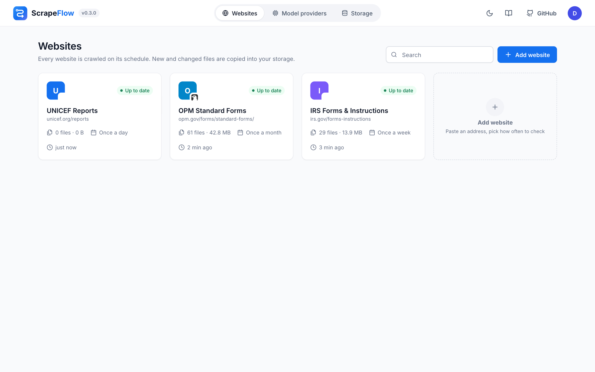
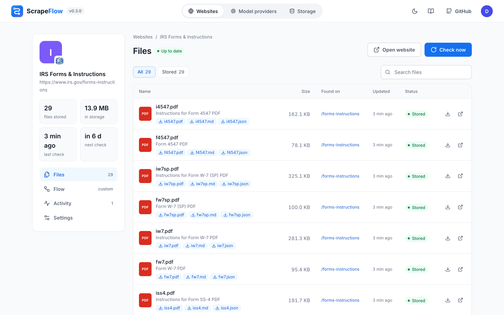
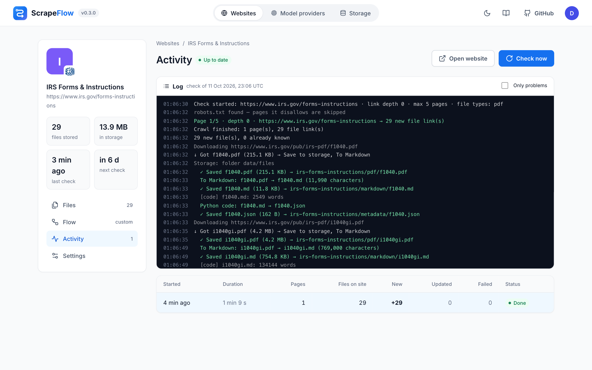

<p align="center">
  
</p>

<p align="center">
  <b>Every file from the web, flowing into your own storage – prepared the way you need it.</b>
</p>

<p align="center">
  <a href="https://github.com/MikiMikulas/scrapeflow/releases/latest"></a>
  <a href="https://github.com/MikiMikulas/scrapeflow/actions/workflows/ci.yml"></a>
  <a href="https://github.com/MikiMikulas/scrapeflow/pkgs/container/scrapeflow"></a>
  <a href="LICENSE"></a>
</p>

<p align="center">
  English · <a href="README_cs.md">Čeština</a>
  &nbsp;|&nbsp; <a href="docs/quickstart.md">Quick start</a>
  &nbsp;|&nbsp; <a href="docs/README.md">Docs</a>
  &nbsp;|&nbsp; <a href="CHANGELOG.md">Changelog</a>
</p>

<p align="center">
  
</p>

ScrapeFlow watches websites for documents – forms, reports, datasets, notices – and keeps a copy of
each one in **your** storage: a folder, an S3 bucket or Nextcloud. It notices when a file changes and
updates your copy. On the way, every file passes through a **flow** you draw yourself, so it can arrive
already converted to Markdown, filtered by your own AI model or reshaped by a few lines of Python.

It is a single self-hosted container with a web dashboard. No cloud account, no external database.

```bash
git clone https://github.com/MikiMikulas/scrapeflow.git && cd scrapeflow
docker compose up -d        # then open http://localhost:8000
```

## From a website to your storage

**1 · Find.** You give ScrapeFlow the page that lists the documents. It follows links on the same
website as deep as you allow, respects `robots.txt`, pauses between requests and recognises files even
behind links like `/download?id=42`.

**2 · Decide.** The flow's filters look at file names, link texts and pages *before* anything is
downloaded – by type, by a pattern, or by asking your model (“only invoices and contracts”). Files
nobody wants are never fetched.

**3 · Prepare.** Wanted files are downloaded and sent on: **To Markdown** turns PDFs, Office documents,
CSVs and HTML into clean Markdown; a **Python code** node can do anything else – extract tables,
rename, split, enrich.

**4 · Keep.** **Save to storage** nodes write the results. On later checks ScrapeFlow asks the server
whether a file changed (`ETag`, `Last-Modified`, otherwise SHA-256) and replaces your copy only when it
did. Files that vanish from the website stay with you.

**5 · Watch.** Each check writes a live log – every page, download, conversion and saved file – and the
file table lists all outputs of every document with a download link.

## A flow in practice

The screenshot above mirrors the forms page of the U.S. tax authority. Every PDF is

- stored as it is in `irs-forms-instructions/pdf/`,
- converted to Markdown in `irs-forms-instructions/markdown/`,
- summarised by a dozen lines of Python into a small JSON record in `irs-forms-instructions/metadata/`.

Before saving, **Test on a file** runs the flow on one document and shows the result:

<p align="center">
  
</p>

## A short tour

<table>
  <tr>
    <td width="50%"><br><sub><b>Websites</b> – one card per site with its schedule and stored files</sub></td>
    <td width="50%"><br><sub><b>Files</b> – every document with all its outputs (PDF, Markdown, JSON)</sub></td>
  </tr>
  <tr>
    <td><br><sub><b>Activity</b> – the live log of each check</sub></td>
    <td><br><sub><b>Storage</b> – local folder, S3-compatible or WebDAV</sub></td>
  </tr>
  <tr>
    <td><br><sub><b>Model providers</b> – optional, for the AI filter</sub></td>
    <td><br><sub><b>Sign-in</b> – an admin account is created on the first start</sub></td>
  </tr>
</table>

<sub>Screenshots come from a demo instance mirroring public forms pages of the IRS and the U.S. Office of
Personnel Management.</sub>

## What's inside

| | |
|---|---|
| **Crawling** | same-host crawl with link depth and page limit · `robots.txt` · polite delays · extension-less download links |
| **Scheduling** | manual, hourly, every 6 hours, daily, weekly, monthly – counted from the last check |
| **Flow nodes** | Filter · AI filter · To Markdown ([MarkItDown](https://github.com/microsoft/markitdown)) · Python code · Save to storage – with branches |
| **Storage** | local folder · S3-compatible (AWS, Cloudflare R2, Backblaze B2, MinIO) · WebDAV (Nextcloud, Synology…) |
| **Models** | OpenAI · Anthropic · OpenRouter · Ollama · LM Studio · Groq · DeepSeek · Mistral · any OpenAI-compatible server |
| **Access** | admin account with sign-in · personal API keys · JSON API with OpenAPI docs · CLI |
| **Runs on** | one container with SQLite · `linux/amd64` and `linux/arm64` · or plain Python 3.11+ |

Markdown output works well as input for retrieval tools such as
[RAGFlow](https://github.com/infiniflow/ragflow) or [Dify](https://github.com/langgenius/dify).

## How it fits together

<p align="center">
  
</p>

## Installing

**Docker Compose** – the command at the top. Add `--profile ollama` to run a local model next to it.

**Container image only**

```bash
docker run -d --name scrapeflow -p 8000:8000 -v scrapeflow-data:/data \
  --add-host host.docker.internal:host-gateway \
  ghcr.io/mikimikulas/scrapeflow:latest
```

**Python**

```bash
pip install "scrapeflow[s3] @ git+https://github.com/MikiMikulas/scrapeflow"
scrapeflow serve
```

Open <http://localhost:8000>, create the admin account, choose a storage, add a website.
The [quick start](docs/quickstart.md) walks through it; server settings are listed in
[configuration](docs/configuration.md).

## Documentation

[Quick start](docs/quickstart.md) ·
[Flows](docs/flows.md) ·
[Storage](docs/storage.md) ·
[Model providers](docs/models.md) ·
[Accounts and security](docs/accounts.md) ·
[Configuration](docs/configuration.md) ·
[API and CLI](docs/api.md) ·
[Plugins](docs/plugins.md) ·
[FAQ](docs/faq.md)

## Where it's going

Next on the list: more flow nodes (chunking, webhooks, OCR, direct upload to retrieval tools),
notifications, multiple users with roles, an optional headless browser for JavaScript-only pages,
per-site headers and cookies, and import/export of websites and flows. Suggestions are welcome in
[Discussions](https://github.com/MikiMikulas/scrapeflow/discussions).

## Getting involved

Bug reports, ideas and pull requests are welcome – new flow nodes and storage or model plugins are a
good place to start. See [CONTRIBUTING.md](CONTRIBUTING.md); security issues go through
[SECURITY.md](SECURITY.md).

**Use it responsibly.** Mirror only websites you are allowed to access, keep schedules reasonable and
follow each site's terms of service.

## License

[Apache License 2.0](LICENSE) · third-party notices in [NOTICE](NOTICE).
