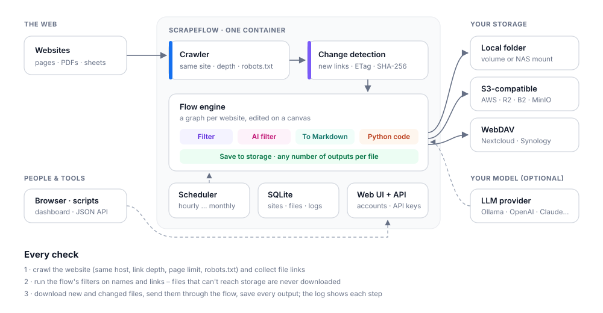

<p align="center">
  
</p>

<p align="center">
  <b>Všechny soubory z webu ve vašem úložišti – připravené tak, jak je potřebujete.</b>
</p>

<p align="center">
  <a href="https://github.com/MikiMikulas/scrapeflow/releases/latest"></a>
  <a href="https://github.com/MikiMikulas/scrapeflow/actions/workflows/ci.yml"></a>
  <a href="https://github.com/MikiMikulas/scrapeflow/pkgs/container/scrapeflow"></a>
  <a href="LICENSE"></a>
</p>

<p align="center">
  <a href="README.md">English</a> · Čeština
  &nbsp;|&nbsp; <a href="docs/quickstart.md">Rychlý start (EN)</a>
  &nbsp;|&nbsp; <a href="docs/README.md">Dokumentace (EN)</a>
  &nbsp;|&nbsp; <a href="CHANGELOG.md">Změny</a>
</p>

<p align="center">
  
</p>

ScrapeFlow hlídá weby, na kterých se objevují dokumenty – formuláře, zprávy, datové sady, úřední
oznámení – a každý z nich si uloží do **vašeho** úložiště: do složky, S3 nebo Nextcloudu. Pozná, když
se soubor změní, a vaši kopii aktualizuje. Cestou každý soubor projde **flow**, které si sami
nakreslíte – takže může dorazit rovnou převedený do Markdownu, vybraný vaším AI modelem nebo upravený
pár řádky Pythonu.

Je to jeden kontejner s webovým rozhraním, který si provozujete sami. Bez cloudového účtu, bez externí
databáze.

```bash
git clone https://github.com/MikiMikulas/scrapeflow.git && cd scrapeflow
docker compose up -d        # pak otevřete http://localhost:8000
```

## Z webu do vašeho úložiště

**1 · Najít.** Zadáte stránku, na které jsou dokumenty odkázané. ScrapeFlow prochází odkazy na stejném
webu do hloubky, kterou povolíte, respektuje `robots.txt`, dělá pauzy mezi požadavky a pozná soubory i
za odkazy typu `/download?id=42`.

**2 · Rozhodnout.** Filtry ve flow posoudí název souboru, text odkazu a stránku *ještě před stažením* –
podle typu, podle vzoru nebo dotazem na váš model („jen faktury a smlouvy“). Nechtěné soubory se vůbec
nestahují.

**3 · Připravit.** Vybrané soubory se stáhnou a putují dál: **To Markdown** převede PDF, dokumenty
Office, CSV a HTML na čistý Markdown, uzel **Python code** zvládne cokoli dalšího – vytáhnout tabulky,
přejmenovat, rozdělit, doplnit metadata.

**4 · Udržovat.** Uzly **Save to storage** uloží výsledky. Při dalších kontrolách se ScrapeFlow zeptá
serveru, jestli se soubor změnil (`ETag`, `Last-Modified`, jinak SHA-256), a kopii nahradí jen tehdy.
Soubory, které z webu zmizí, vám zůstanou.

**5 · Sledovat.** Každá kontrola píše živý log – každou stránku, stažení, převod i uložený soubor – a
tabulka souborů ukazuje všechny výstupy každého dokumentu s odkazem ke stažení.

## Flow v praxi

Snímek nahoře zrcadlí stránku s formuláři americké daňové správy. Každé PDF se

- uloží tak, jak je, do `irs-forms-instructions/pdf/`,
- převede na Markdown do `irs-forms-instructions/markdown/`,
- tuctem řádků Pythonu shrne do malého JSON záznamu v `irs-forms-instructions/metadata/`.

Před uložením si flow vyzkoušíte tlačítkem **Test on a file** na jednom dokumentu:

<p align="center">
  
</p>

## Co umí

| | |
|---|---|
| **Procházení** | stejná doména, hloubka odkazů a limit stránek · `robots.txt` · pauzy · odkazy ke stažení bez přípony |
| **Plánování** | ručně, každou hodinu, 6 h, denně, týdně, měsíčně – počítáno od poslední kontroly |
| **Uzly flow** | Filter · AI filter · To Markdown ([MarkItDown](https://github.com/microsoft/markitdown)) · Python code · Save to storage – s větvením |
| **Úložiště** | lokální složka · S3 (AWS, Cloudflare R2, Backblaze B2, MinIO) · WebDAV (Nextcloud, Synology…) |
| **Modely** | OpenAI · Anthropic · OpenRouter · Ollama · LM Studio · Groq · DeepSeek · Mistral · cokoli kompatibilního s OpenAI API |
| **Přístup** | admin účet s přihlášením · osobní API klíče · JSON API s dokumentací OpenAPI · CLI |
| **Běží na** | jeden kontejner se SQLite · `linux/amd64` i `linux/arm64` · nebo Python 3.11+ |

Výstup v Markdownu se hodí jako vstup pro nástroje na vyhledávání v dokumentech, například
[RAGFlow](https://github.com/infiniflow/ragflow) nebo [Dify](https://github.com/langgenius/dify).

## Jak to do sebe zapadá

<p align="center">
  
</p>

## Instalace

**Docker Compose** – příkaz výše. S `--profile ollama` poběží vedle i lokální model.

**Jen kontejner**

```bash
docker run -d --name scrapeflow -p 8000:8000 -v scrapeflow-data:/data \
  --add-host host.docker.internal:host-gateway \
  ghcr.io/mikimikulas/scrapeflow:latest
```

**Python**

```bash
pip install "scrapeflow[s3] @ git+https://github.com/MikiMikulas/scrapeflow"
scrapeflow serve
```

Otevřete <http://localhost:8000>, založte admin účet, zvolte úložiště a přidejte web. Zapomenuté heslo:
`docker compose exec scrapeflow scrapeflow reset-password vas@email.cz`.

## Dokumentace

Podrobné návody jsou v angličtině:
[rychlý start](docs/quickstart.md) ·
[flow](docs/flows.md) ·
[úložiště](docs/storage.md) ·
[modely](docs/models.md) ·
[účty a bezpečnost](docs/accounts.md) ·
[nastavení](docs/configuration.md) ·
[API a CLI](docs/api.md) ·
[pluginy](docs/plugins.md) ·
[FAQ](docs/faq.md)

## Kam to směřuje

Další uzly flow (dělení na části, webhooky, OCR, přímé nahrání do vyhledávacích nástrojů), notifikace,
více uživatelů s rolemi, volitelný prohlížeč pro stránky postavené na JavaScriptu, vlastní hlavičky a
cookies pro weby a import/export webů a flow. Nápady vítáme v
[diskuzích](https://github.com/MikiMikulas/scrapeflow/discussions).

## Zapojte se

Chyby, nápady i pull requesty jsou vítané – dobrým začátkem jsou nové uzly flow a pluginy úložišť nebo
modelů. Viz [CONTRIBUTING.md](CONTRIBUTING.md), bezpečnostní problémy přes [SECURITY.md](SECURITY.md).

**Používejte ohleduplně.** Zrcadlete jen weby, ke kterým máte přístup, volte rozumné intervaly a
dodržujte podmínky jednotlivých webů.

## Licence

[Apache License 2.0](LICENSE) · komponenty třetích stran v [NOTICE](NOTICE).
