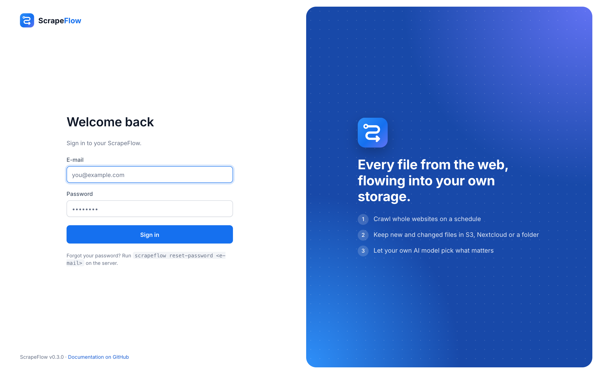

# Accounts and security

## Sign-in

- **First start** – while there is no account, every page leads to *Set up your admin account*
  (name, e-mail, password with at least 8 characters). The new account is signed in immediately.
- **Sign-in page** – afterwards you sign in with that e-mail and password. ScrapeFlow currently has
  one administrator account (multiple users are on the roadmap). The browser gets an
  HTTP-only, `SameSite=Lax` session cookie valid for 30 days.
- **Brute-force protection** – after 5 wrong passwords a client has to wait a minute.
- **Sign out** – avatar menu → *Sign out*.



## Account page

Avatar menu → **Account & API key**:

- change your name and e-mail,
- change your password – this signs out every other browser,
- create, replace or revoke your **API key**.

## API keys

Scripts and tools call the JSON API with the key in a header:

```bash
curl -H "Authorization: Bearer sf-…" http://localhost:8000/api/sites
```

The key is shown once, when it is created. Only its hash is stored. See [API](api.md).

## Forgotten password

```bash
scrapeflow reset-password you@example.com
# Docker:
docker compose exec scrapeflow scrapeflow reset-password you@example.com
```

It asks for the new password twice and signs out all browsers of that account.

## What is stored

- Passwords are hashed with **scrypt**; session cookies and API keys are stored only as SHA-256 hashes.
- API keys of model providers and storage secrets are stored in the SQLite database in the data
  volume – protect that volume like any other secret store.

## Running on a server

- Put ScrapeFlow behind a reverse proxy with HTTPS (Caddy, Traefik, nginx). The session cookie is
  marked *Secure* automatically for HTTPS requests; if the proxy terminates TLS and talks plain HTTP to
  ScrapeFlow, set `SCRAPEFLOW_SECURE_COOKIES=true`.
- `SCRAPEFLOW_AUTH_DISABLED=true` turns sign-in off. Use it only when your own proxy already
  authenticates every request (e.g. an SSO forward-auth).
- The account can edit flows, including the **Python code** node, which runs code on the server.
  Share the credentials only with people you would trust with shell access.

Found a vulnerability? See [SECURITY.md](../SECURITY.md).
