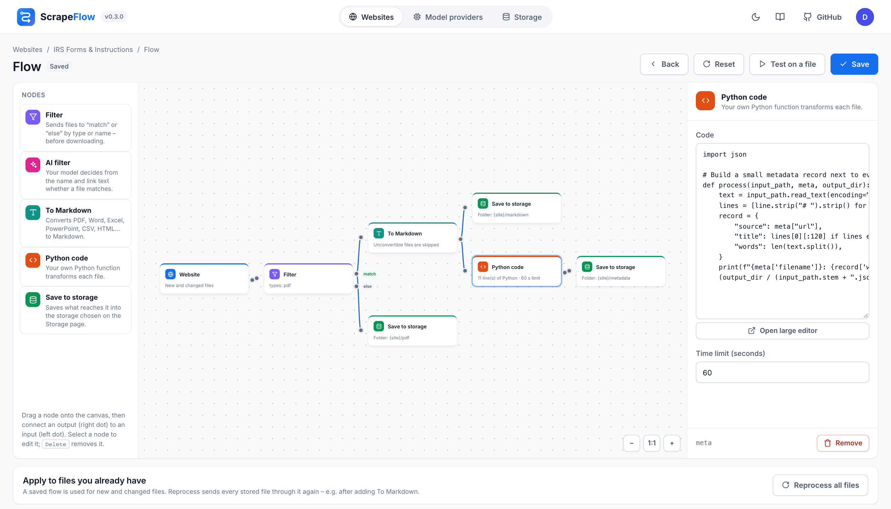
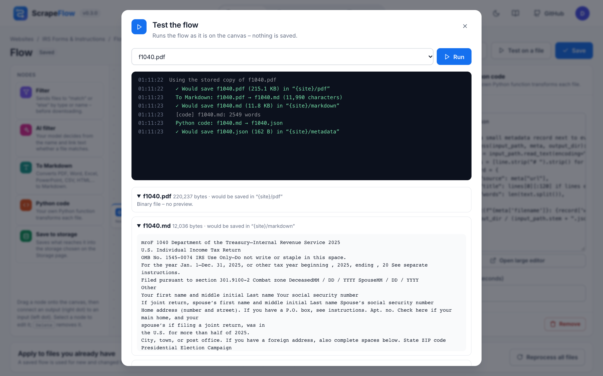

# Flows

A flow decides what happens to every new or changed file of a website. It is a graph drawn on a canvas:
files enter at the **Website** node, travel along the connections and are saved by **Save to storage**
nodes. Open it from the website's menu → **Flow**.



## Nodes

| Node | Outputs | What it does |
|------|---------|--------------|
| **Website** | `files` | The start. Every file the crawler found that is new or changed since the last check. |
| **Filter** | `match`, `else` | Checks the file type (`pdf, docx`) and/or a regular expression matched against the file name, the link text and the URL (case-insensitive). |
| **AI filter** | `match`, `else` | Your model decides from the file name, link text and page whether the file matches plain-language instructions (“invoices, contracts and price lists”). |
| **To Markdown** | `markdown` | Converts PDF, Word, Excel, PowerPoint, CSV, HTML, XML, JSON, EPUB and more with [MarkItDown](https://github.com/microsoft/markitdown), locally. A file that can't be converted is skipped, or passed on unchanged if you choose so. |
| **Python code** | `out` | Runs your `process()` function – see below. |
| **Save to storage** | – | Saves what reaches it into the active storage. Folder template: `{site}` (the website's folder) and `{ext}` (file type). Empty = `{site}`. |

## How files move

- **One output, many connections.** Connect an output to several nodes to keep the original *and* a
  Markdown copy, or send PDFs and spreadsheets different ways.
- **Filters run before the download.** Filter and AI filter only look at names and links, so ScrapeFlow
  evaluates them first. A file that cannot reach a *Save to storage* node is never downloaded; the file
  table lists it as *Filtered out by …*.
- **Each output is tracked.** Every saved output (original, `.md`, files written by your code) appears
  under its source file in the file table with its own download link. When the source changes, the flow
  runs again and the outputs are overwritten in place – no `-2` copies.
- **Errors stay local.** If a node fails for one file (a broken PDF, an exception in your code), only
  that file is marked as failed; the check carries on and retries it next time.

## Editing

- Drag nodes from the left panel (or click them to add next to the last node).
- Connect a node's **output** (dot on the right) to another node's **input** (dot on the left).
- Click a node to edit its settings on the right; <kbd>Delete</kbd> or **Remove** deletes it. The
  Website node can't be removed.
- Click a connection and press <kbd>Delete</kbd> to remove it.
- **Save** validates the flow: exactly one Website node, no loops, valid regular expressions, Python
  code that compiles. Problems are shown above the canvas.
- **Reset** replaces the canvas with `Website → Save to storage`.

## Testing

**Test on a file** runs the flow *as it is on the canvas* – unsaved changes included – for one file of
the website and shows the log plus every output with a preview. Nothing is written to storage.
Stored files are read from storage; others are downloaded again.



## Applying a new flow to existing files

A saved flow is used for new and changed files. **Reprocess all files** (below the canvas) downloads
every stored file again and sends it through the saved flow – use it after adding *To Markdown* or
changing your code.

## Python code node

```python
import json

def process(input_path, meta, output_dir):
    """Runs once for every file that reaches the node.

    input_path – pathlib.Path of the file
    meta       – dict: filename, url, link_text, page_url, content_type, site
    output_dir – pathlib.Path; every file written here continues to the next node
    """
    text = input_path.read_text(encoding="utf-8", errors="replace")
    print(f"{meta['filename']}: {len(text.split())} words")      # shows up in the log
    (output_dir / (input_path.stem + ".json")).write_text(
        json.dumps({"source": meta["url"], "words": len(text.split())}))
```

- **Return a string** (or bytes) instead of writing files to save it as `<name>.md`.
- **Write nothing and return nothing** to drop the file.
- `print()` output and tracebacks appear in the Activity log; an exception marks only that file as
  failed, with the message and line number.
- The code runs with the same Python as ScrapeFlow, in a separate process (`python -I`) inside a
  temporary folder, with a time limit (default 60 s). Packages installed in the image are available.

> **Security:** the code node is not a sandbox – it can do anything the ScrapeFlow process can. Only
> the signed-in administrator can edit flows; don't share the account with people you wouldn't give
> shell access to the server.

## AI filter node

The node sends the names, link texts and pages of new files to the model configured on
**Model providers** – in batches of up to 150, once per check – and only matching files continue.
Without a model, or if the request fails, the node lets every file through and says so in the log.
See [Model providers](models.md).

## Recipes

**Keep the original and a Markdown copy for RAG**

`Website → Save to storage ({site}/original)` and `Website → To Markdown → Save to storage ({site}/markdown)`

**Only invoices and contracts, as Markdown**

`Website → AI filter (“invoices and contracts”) → match → To Markdown → Save to storage`

**PDFs to Markdown, everything else as it is**

`Website → Filter (pdf) → match → To Markdown → Save to storage`, and `Filter → else → Save to storage`

## Flow JSON

Flows are stored as JSON and can be read and written through the API
(`GET/PUT /api/sites/{id}/flow`):

```json
{
  "nodes": [
    {"id": "source", "type": "source", "x": 0, "y": 150, "config": {}},
    {"id": "md", "type": "markdown", "x": 300, "y": 150, "config": {"on_error": "drop"}},
    {"id": "out", "type": "storage", "x": 600, "y": 150, "config": {"folder": "{site}/markdown"}}
  ],
  "edges": [
    {"from": "source", "out": "files", "to": "md"},
    {"from": "md", "out": "markdown", "to": "out"}
  ]
}
```
