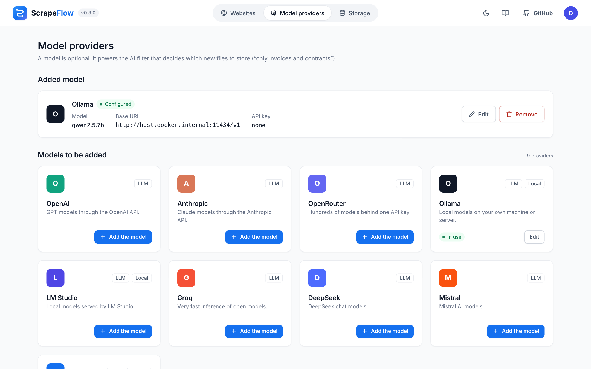

# Model providers

A model is **optional**. ScrapeFlow uses it only in the **AI filter** flow node, to decide from file
names and link texts which files to keep. Everything else – crawling, Markdown conversion, Python
code – works without one.



Pick a card on **Model providers**, fill in the fields, press **Test** (a tiny request that must return
JSON) and **Save**. One model is active at a time.

| Card | Base URL | API key | Example model |
|------|----------|---------|---------------|
| OpenAI | `https://api.openai.com/v1` | yes | `gpt-4.1-mini` |
| Anthropic | – | yes | `claude-opus-5-5` |
| OpenRouter | `https://openrouter.ai/api/v1` | yes | `meta-llama/llama-3.3-70b-instruct` |
| Ollama | `http://host.docker.internal:11434/v1` | – | `qwen2.5:7b` |
| LM Studio | `http://host.docker.internal:1234/v1` | – | `qwen2.5-7b-instruct` |
| Groq | `https://api.groq.com/openai/v1` | yes | `llama-3.3-70b-versatile` |
| DeepSeek | `https://api.deepseek.com/v1` | yes | `deepseek-chat` |
| Mistral | `https://api.mistral.ai/v1` | yes | `mistral-small-latest` |
| OpenAI-compatible | any `/v1` root (vLLM, llama.cpp, LocalAI, Together…) | optional | – |

- **Inside Docker, `localhost` is the container.** Use `host.docker.internal` to reach a model server
  on your computer (`docker-compose.yml` maps it on Linux too).
- The key is stored in the database and never shown again; leave the field empty to keep it. Switching
  to another service drops the saved key so it can't leak to a different provider.
- Structured output support differs between servers, so the OpenAI-compatible provider tries
  `json_schema`, then `json_object`, then plain JSON from the prompt.
- Models of roughly 7B parameters and up handle the AI filter well.

## Ollama in the same compose project

```bash
docker compose --profile ollama up -d
docker compose exec ollama ollama pull qwen2.5:7b
```

Then use the **Ollama** card with base URL `http://ollama:11434/v1` and model `qwen2.5:7b`.

## Environment defaults

`SCRAPEFLOW_AI_PROVIDER` (`openai` or `anthropic`), `SCRAPEFLOW_AI_BASE_URL`, `SCRAPEFLOW_AI_MODEL` and
`SCRAPEFLOW_AI_API_KEY` set defaults; whatever is saved on the page wins. Without a key ScrapeFlow
also reads `OPENAI_API_KEY` / `ANTHROPIC_API_KEY`.

## Your own provider

Providers are plugins – see [Plugins](plugins.md#model-providers).
