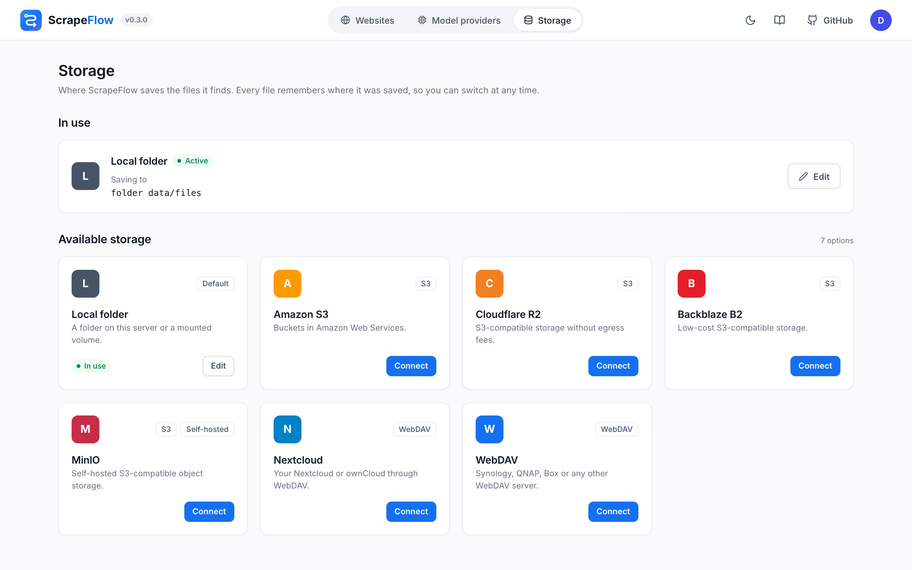

# Storage

Storage is where *Save to storage* nodes put files. Choose it on the **Storage** page: pick a card,
fill in the details, press **Test** (ScrapeFlow writes, reads back and deletes a small file) and
**Save & use**.



- Settings are kept **per backend**, so you can switch back and forth without retyping them.
- Every stored file remembers which backend it was saved to; downloads keep working after you switch.
- Secrets (secret keys, passwords) are stored in the database and are never sent back to the browser
  or the API. Leave a secret field empty to keep the saved value.
- Files are saved as `<folder>/<file name>`. The folder comes from the storage node (`{site}` = the
  website's folder, which defaults to a slug of its name). Two different files with the same name get
  `-2`, `-3`…; a new version of the same file overwrites it.

## Local folder

| Setting | Notes |
|---------|-------|
| Folder | Default: `SCRAPEFLOW_FILES_DIR`, or `/data/files` inside the Docker volume. |

To get files into a folder on the host, uncomment the two marked lines in `docker-compose.yml`:

```yaml
    environment:
      SCRAPEFLOW_FILES_DIR: /downloads
    volumes:
      - ./downloads:/downloads
```

On Linux create the folder first and make it writable for UID 10001: `mkdir -p downloads && sudo chown 10001 downloads`.

## S3-compatible

Cards: *Amazon S3*, *Cloudflare R2*, *Backblaze B2*, *MinIO* – they all use the same backend.

| Setting | Notes |
|---------|-------|
| Bucket | Must exist. |
| Endpoint URL | Empty for AWS. R2: `https://<account-id>.r2.cloudflarestorage.com` · B2: `https://s3.<region>.backblazeb2.com` · MinIO: `http://minio:9000` |
| Region | e.g. `eu-central-1`; R2 uses `auto`. |
| Access key ID / Secret access key | A key that may `PutObject`, `GetObject` and `DeleteObject` in the bucket. |
| Key prefix | Optional folder inside the bucket, e.g. `scrapeflow/`. |

Downloads from the dashboard are streamed through ScrapeFlow, so internal endpoints such as
`http://minio:9000` work even though browsers can't reach them.

## WebDAV

Cards: *Nextcloud*, *WebDAV* (Synology, QNAP, ownCloud, Box, …).

| Setting | Notes |
|---------|-------|
| WebDAV URL | Nextcloud: `https://cloud.example.com/remote.php/dav/files/<user>/` (Files → Settings, bottom left) |
| Username / Password | For Nextcloud create an *app password* (Settings → Security). |
| Folder | Created automatically, e.g. `ScrapeFlow`. |

## Your own backend

Storage backends are plugins – see [Plugins](plugins.md#storage-backends).
